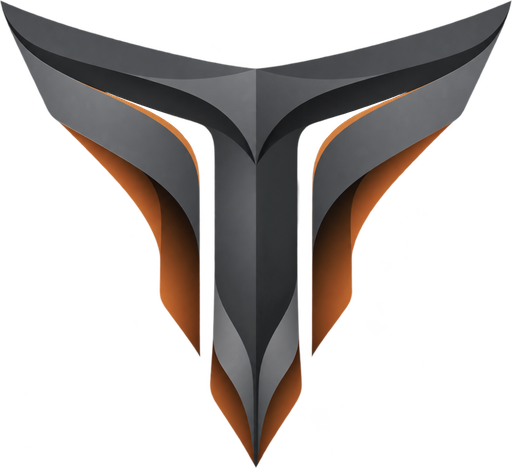

<p align="center">

</p>

<h1 align="center">TarisOS</h1>

<p align="center">
A minimal, fast, low-power desktop for Apple Silicon Macs.
</p>

<p align="center">
<a href="#installation">Installation</a> ·
<a href="#features">Features</a> ·
<a href="#using-tarisos">Using TarisOS</a> ·
<a href="#getting-help">Getting help</a> ·
<a href="#building-tarisos">Building</a> ·
<a href="#license">License</a>
</p>

---

TarisOS is a Linux desktop for M1 and M2 Macs. It's built on [Asahi Linux](https://asahilinux.org/)
and Arch Linux ARM, uses [Hyprland](https://hypr.land) for windows, and comes with its own desktop
shell, Taris.

It installs next to macOS with one command and starts as a finished desktop, ready to use. Nothing
runs unless it has to, so the Mac stays quiet and cool, and the battery lasts.

> [!NOTE]
> Please back up anything important on your Mac before installing.

## Contents

- [Installation](#installation)
- [Features](#features)
- [Supported Macs](#supported-macs)
- [Using TarisOS](#using-tarisos)
- [Configuration](#configuration)
- [Removing TarisOS](#removing-tarisos)
- [Getting help](#getting-help)
- [Building TarisOS](#building-tarisos)
- [Contributing](#contributing)
- [Repository layout](#repository-layout)
- [Credits](#credits)
- [License](#license)

## Installation

Before you start, you'll need:

- an M1 or M2 Mac with **macOS 13.5 or newer**
- some free disk space (the installer asks how much; 30 GB or more is comfortable)
- an internet connection
- a backup of anything important

**1. Run the installer from macOS.** Open Terminal and paste:

```sh
curl -fsSL https://github.com/TarisOS/tarisOS/releases/latest/download/install.sh | sh
```

This starts Asahi Linux's installer, set up for TarisOS. It asks for your macOS password, how much
space to give TarisOS, and what to call it on the Mac's startup screen. Then it downloads TarisOS
and installs it alongside macOS. The only change to macOS is that its partition gets smaller.

**2. Let TarisOS start.** Apple requires this for any other operating system. When the installer
tells you to, shut the Mac down, then press and hold the power button until you see "Loading
startup options". Choose TarisOS and follow the instructions; you'll be asked for your macOS
password one more time.

**3. Set up TarisOS.** The setup screen asks for your keyboard, a Wi-Fi network (optional), your
time zone and your account. Once that's done, you're on your new desktop.

To choose between macOS and TarisOS, hold the power button when the Mac starts. You can change
which one starts by default in macOS, under System Settings > General > Startup Disk.

## Features

### The desktop

The Taris shell gives you a bar, a dock, an app launcher and drawer, notifications, a dashboard,
a window overview and a lock screen, built with [Quickshell](https://quickshell.outfoxxed.me).

The Settings app (<kbd>SUPER</kbd> + <kbd>,</kbd>) covers almost everything, from network and
displays to colours, security, backups and updates, and its search finds individual options.

The App Store brings Arch Linux ARM, Flathub, the AUR and TarisOS's own repository into one place.
You can also install from the launcher by typing `>install`.

Colours come from TarisOS's own theme, any of the bundled schemes, or your wallpaper, and you can
tweak them and save your own themes.

Coding agents get a terminal in the dashboard and a workspace of their own (<kbd>SUPER</kbd> +
<kbd>A</kbd>). Claude Code is the default, installed the first time you open it, and agents get
instructions about the system so they know where things live and what not to touch.

### The system

You log in once, on a screen that looks like the lock screen. With disk encryption on, your disk
password is your login, so it's still the only password you type. Encryption can be turned on at
any time from Settings > Security.

Settings > Backup & restore backs up the whole system, everyone's files included, on demand or on
a schedule, and can restore any backup or reset TarisOS to how it was installed. A snapshot is also
taken before every package change.

Settings > General > Updates updates everything at once, from the system to AUR and Flatpak apps.

The firewall lets nothing in unless your Mac asked for it, and an account locks for ten minutes
after ten wrong passwords.

### Apple Silicon hardware

On top of what Asahi Linux provides, TarisOS adds its own fixes and features:

- Asahi's sound processing and speaker protection, with the microphone on both sides for stereo
  apps
- Spatial audio on MacBook speakers and headphones
- External displays over HDMI, Silicon Motion USB adapters and, on M1 Macs, one USB-C port, with
  each monitor remembering its settings
- Wi-Fi that comes back reliably after sleep and uses the right channels for your country
- A keyboard and trackpad that work from the moment the Mac starts
- Hardware video decoding for H.264, HEVC and VP9
- Fan control in the bar and a battery charge limit
- A Touch Bar with media, brightness and screenshot keys, and a layout you can change

### Apps

| | |
| --- | --- |
| Browser | Chromium, with Google sign-in and sync, and streaming video |
| Private browsing | Tor Browser |
| Terminal | kitty |
| Files | Nautilus |
| Text | GNOME Text Editor, Neovim |
| Code | VSCodium |
| Music | Taris Music, a YouTube Music player without the ads |
| Images, video, PDFs | imv, mpv, VLC, Evince |
| Disks | GNOME Disks |
| Phone | KDE Connect |
| Torrents | qBittorrent |
| Screenshots | The shell's own tool, with swappy for editing |
| Privacy | Tor for the whole system, from the taskbar; NordVPN |
| GitHub | GitHub CLI |

VSCodium, Steam, OBS Studio, LibreOffice, Firefox and NordVPN are in the launcher and download the
first time you open them. Chinese, Japanese and Korean input installs when you turn it on in
Settings > Keyboard & trackpad.

## Supported Macs

TarisOS runs on the Apple Silicon Macs that Asahi Linux supports, which are the **M1** and **M2**
families. It's developed and tested on an M1 MacBook Pro, and hasn't been tried on M2 Macs yet. It
only targets Apple Silicon, so there are no drivers for other hardware.

Hardware support comes from Asahi Linux, and their [website](https://asahilinux.org/) lists what
works on each model. A few things are worth knowing before you install:

- Touch ID doesn't work on Linux.
- On M1 Macs, external displays work over one USB-C port only. That's the front port on the left of
  a MacBook Air or MacBook Pro, the back port next to HDMI on a Mac mini, and on an iMac the back
  left port (two ports) or the back middle-right port (four ports). Other M-series Macs can't drive
  a display over USB-C yet. HDMI and Silicon Motion USB adapters work everywhere; DisplayLink
  adapters don't.
- Apps need to be built for 64-bit ARM. Steam runs its games through x86 emulation, but other
  x86-only programs may not work.

## Using TarisOS

### Shortcuts

| Keys | Action |
| --- | --- |
| <kbd>SUPER</kbd> + <kbd>SPACE</kbd> | App launcher |
| <kbd>SUPER</kbd> + <kbd>RETURN</kbd> | Terminal |
| <kbd>SUPER</kbd> + <kbd>B</kbd> | Browser |
| <kbd>SUPER</kbd> + <kbd>E</kbd> | Files |
| <kbd>SUPER</kbd> + <kbd>,</kbd> | Settings |
| <kbd>SUPER</kbd> + <kbd>TAB</kbd> or <kbd>SUPER</kbd> + <kbd>`</kbd> | Window overview |
| <kbd>SUPER</kbd> + <kbd>N</kbd> | Notifications |
| <kbd>SUPER</kbd> + <kbd>A</kbd> | Show or hide the coding agent |
| <kbd>SUPER</kbd> + <kbd>V</kbd> | Clipboard history |
| <kbd>SUPER</kbd> + <kbd>K</kbd> | All keyboard shortcuts |
| Hold <kbd>fn</kbd> | Emoji picker |
| <kbd>fn</kbd> twice | Switch keyboard layout |
| <kbd>SUPER</kbd> + <kbd>L</kbd> | Lock |
| <kbd>SUPER</kbd> + <kbd>ESC</kbd> | Log out, sleep, restart or shut down |
| <kbd>PRINT</kbd> | Screenshot |
| <kbd>SUPER</kbd> + <kbd>SHIFT</kbd> + <kbd>R</kbd> | Record part of the screen |
| <kbd>CTRL</kbd> + <kbd>Q</kbd> or <kbd>SUPER</kbd> + <kbd>W</kbd> | Close the window |
| <kbd>SUPER</kbd> + <kbd>F</kbd> | Fullscreen |
| <kbd>SUPER</kbd> + <kbd>SHIFT</kbd> + <kbd>M</kbd> | Maximise |
| <kbd>SUPER</kbd> + <kbd>M</kbd> | Minimise to the dock |
| <kbd>SUPER</kbd> + <kbd>T</kbd> | Float or tile the window |
| <kbd>SUPER</kbd> + arrows | Move focus |
| <kbd>SUPER</kbd> + <kbd>1</kbd>–<kbd>9</kbd> | Go to a workspace |
| <kbd>SUPER</kbd> + <kbd>SHIFT</kbd> + <kbd>1</kbd>–<kbd>9</kbd> | Move the window to a workspace |
| <kbd>SUPER</kbd> + <kbd>S</kbd> | Show or hide the special workspace |
| Three-finger swipe sideways | Switch workspace |
| Three-finger swipe up or down | Open or close the overview |

TarisOS swaps the left <kbd>CTRL</kbd> and <kbd>SUPER</kbd> keys, so <kbd>⌘</kbd> behaves the way
it does on macOS (<kbd>⌘</kbd> + <kbd>C</kbd> to copy, <kbd>⌘</kbd> + <kbd>Q</kbd> to quit) and the
<kbd>SUPER</kbd> shortcuts above are on the <kbd>control</kbd> key. You can turn this off in
Settings > Keyboard & trackpad.

### Installing and updating

Apps come from the App Store in the launcher, or you can type `>install` and a name. To remove one,
type `>uninstall`, or right-click it in the app drawer.

Updates are in Settings > General > Updates. TarisOS takes a snapshot first, then updates the
system, its own packages, AUR apps and Flatpak apps in one go.

Under the hood TarisOS is Arch Linux ARM, so `pacman`, `yay` and `flatpak` all work as you'd
expect. Install with `sudo pacman -Syu --needed <package>` rather than `-Sy` on its own, which can
leave the system half-updated.

### Encryption, backups and factory reset

To encrypt the disk, go to Settings > Security and choose *Encrypt the disk*. The Mac restarts,
asks you for a new disk password, and encrypts the disk while showing its progress. After that,
your disk password is also your login.

Backups live in Settings > Backup & restore. Each one holds the whole system, everyone's files
included, and up to 20 are kept. Restoring a backup restarts the Mac and puts everything back as
it was. The same page has the factory reset, which erases every account, file and backup and
starts the setup screen again.

### Displays

Settings > Displays is where you arrange your screens and set their resolution, scale, rotation and
mirroring. It's also where you pick the main display, choose which displays show the taskbar, and
turn on night light. Each monitor keeps its settings, whichever port or adapter you plug it into.

### Touch Bar

The Touch Bar shows media, brightness and screenshot keys, and switches to
<kbd>F1</kbd>–<kbd>F12</kbd> while you hold <kbd>fn</kbd>. Its layout belongs to the Mac's first account and lives in
`~/.config/taris/touchbar.toml`. You can change the keys there, or set `MediaLayerDefault = false`
to show the F-keys by default. Changes take effect as soon as you save.

### Wallpapers

Your wallpapers live in `~/Pictures/Wallpapers`, and the ones TarisOS comes with are in its
`TarisOS` folder. Pick one in Settings > Appearance > Wallpaper & style, or run
`taris wallpaper -f <path>`.

### Hyprland

TarisOS's Hyprland configuration updates along with the system. Your own changes go in
`~/.config/hypr/user.lua`, which loads last, so anything you set there wins. Window style,
displays and keyboard are easier to change in Settings.

### The shell from a terminal

```sh
taris shell -d    # start the shell (Hyprland normally does this)
taris shell -l    # show its log
taris shell -s    # list everything it can be asked to do, for example:
taris shell mpris getActive trackTitle
```

## Configuration

Settings covers what most people want to change. Everything it saves, and everything you add
yourself, lives in your home folder and sits on top of TarisOS's defaults, so updates never
overwrite it.

| File | Holds |
| --- | --- |
| `~/.config/taris/shell.json` | The shell's options: bar, dock, launcher, notifications, idle, appearance and more |
| `~/.config/taris/monitors/<monitor>/shell.json` | Options for one display |
| `~/.config/taris/window-style.conf` | Borders, gaps, corners, animations, blur and transparency |
| `~/.config/taris/colour-overrides.json` | Your colour changes and saved themes |
| `~/.config/taris/touchbar.toml` | The Touch Bar layout |
| `~/.config/hypr/user.lua` | Your own Hyprland settings, shortcuts and window rules |

`shell.json` only needs the options you want to change; it reloads as soon as you save. Every
option and its default is listed in the shell's source, in
[`shell/plugin/src/Taris/Config/`](shell/plugin/src/Taris/Config/), with one file per section
(`barconfig.hpp` for `bar`, and so on). Not every option can be set per display.

Per-display folders are named after the monitor itself, so its settings follow it wherever it's
plugged in. You can list the names with:

```sh
hyprctl monitors -j | jq -r '.[].description'
```

The built-in display is just `eDP-1`, and so is any pair of identical monitors that have no serial
number. Any `/` in a name becomes `-`. For example, this hides the bar on a Dell monitor until you
move the pointer to it:

**`~/.config/taris/monitors/Dell Inc. P2422H 7Q1KX/shell.json`**

```json
{
    "bar": {
        "persistent": false
    }
}
```

Displays other than the main one only get the bar, dock and panels if you turn them on in
Settings > Displays.

For finer control, `~/.config/taris/shell-tokens.json` adjusts the shell's internal sizes,
spacing, fonts and animation timings
([`tokens.hpp`](shell/plugin/src/Taris/Config/tokens.hpp) lists them). These are internal, so they
can change between versions.

## Removing TarisOS

TarisOS is removed from macOS. Make a backup first, then follow Asahi Linux's
[partitioning guide](https://asahilinux.org/docs/sw/partitioning-cheatsheet/) to delete its
partitions and give the space back to macOS. Take care to check each partition before you delete
it, because picking the wrong one will erase macOS.

## Getting help

When something isn't working, the logs are a good place to start: `taris shell -l` for the shell,
and `journalctl -b -p warning` for the rest of the system.

If you've found a bug in TarisOS, please check the
[existing issues](https://github.com/TarisOS/tarisOS/issues) and open a new one if it isn't there.
Say what happened, what you expected and how to make it happen again, and include your Mac's model
and the output of:

```sh
uname -r; hyprctl version | head -1
pacman -Q taris taris-shell quickshell-taris taris-cli hyprland
```

Problems with the hardware, the kernel or its drivers belong to
[Asahi Linux](https://github.com/AsahiLinux).

## Building TarisOS

TarisOS is built on an Apple Silicon Mac running Asahi Linux with Arch Linux ARM. You build the
package repository first, then the installer image from it, and everything ends up in
`distro/out/`.

```sh
git clone https://github.com/TarisOS/tarisOS.git
cd tarisOS

distro/make-signing-key.sh    # once, to create the signing key (back it up)
distro/build-repo.sh          # build and sign every package
sudo distro/build-image.sh    # build the installer image from that repository
```

`build-repo.sh` builds the packages in `packaging/pkgbuilds/` along with the AUR packages listed
in `distro/config.sh`, showing you any AUR PKGBUILD that has changed before building it. It
installs the tools it needs, and keeps the source of everything it builds in `distro/out/sources`,
as the GPL requires.

`build-image.sh` produces `distro/out/images/tarisos.zip` in the format Asahi Linux's installer
expects, together with `installer_data.json` and `install.sh`.

To publish a release:

- Upload everything in `distro/out/repo` to the `packages` release of
  [tarisOS-packages](https://github.com/TarisOS/tarisOS-packages). Because release assets can't be
  links, upload `taris.db`, `taris.files` and their `.sig` files as copies of the `.tar.gz` files
  with the same names.
- Publish a release of this repository, such as `v1.0.0`, with `tarisos.zip`,
  `installer_data.json` and `install.sh` from `distro/out/images`. Don't mark it as a pre-release:
  the install command always uses the latest full release. GitHub accepts files up to 2 GB.

## Contributing

You can work on the shell and the desktop on any Asahi Linux install with Arch Linux ARM:

```sh
git clone https://github.com/TarisOS/tarisOS.git
cd tarisOS
./install.sh
```

`install.sh` builds the shell from your checkout and installs it with TarisOS's desktop packages,
then restarts the shell and checks that it loaded. Run it again after each change. The login
screen, hardware fixes, snapshots and firewall only come with the full TarisOS image.

Conventions for code, packaging and documentation, and the checks to run before sending a change,
are in [`AGENTS.md`](AGENTS.md) and [`agents/skills/`](agents/skills/). They're written for people
and coding agents alike. If you develop TarisOS on a Mac running it, install the `taris-dev`
package so coding agents treat the machine as a development one.

## Repository layout

| Path | Contents |
| --- | --- |
| `shell/` | The Taris shell, including the login screen and the first-boot setup |
| `music/` | Taris Music |
| `packaging/pkgbuilds/` | Every TarisOS package, TarisOS's patched builds of other packages, and packages Arch Linux ARM doesn't have |
| `packaging/hypr/` | The Hyprland configuration |
| `packaging/agents/` | Instructions for users' coding agents |
| `packaging/defaults/`, `packaging/wallpapers/` | The Taris theme, the bundled web apps, the logo and the wallpapers |
| `packaging/titlebars/` | The window title bar plugin |
| `packaging/extras/`, `packaging/smidriver/` | Touch Bar and display adapter support for `install.sh` |
| `distro/` | Builds the package repository and the installer image |
| `install.sh`, `install-hypr.sh`, `install-agent-skills.sh` | Install the desktop on an existing Asahi Linux system |
| `AGENTS.md`, `CLAUDE.md`, `agents/skills/` | How to work on TarisOS |

## Credits

The Taris shell started as the [Caelestia shell](https://github.com/caelestia-dots/shell) by
[@soramanew](https://github.com/soramanew) and its contributors, and much of its code is still
theirs, renamed and reworked for TarisOS. The `taris` command-line tool is built from
[Caelestia's CLI](https://github.com/caelestia-dots/cli). Many thanks to the Caelestia project.

TarisOS stands on [Asahi Linux](https://asahilinux.org/), whose installer and
[tiny-dfr](https://github.com/AsahiLinux/tiny-dfr) Touch Bar daemon it uses, and on
[Arch Linux ARM](https://archlinuxarm.org/), [Quickshell](https://quickshell.outfoxxed.me) by
[@outfoxxed](https://github.com/outfoxxed), and [Hyprland](https://hypr.land).

Thanks also to the [Omarchy-Mac](https://github.com/omarchy-mac/omarchy-mac) project,
whose installer showed which fixes Apple Silicon Macs need and how to apply them safely.

The wallpapers come from [wallhaven](https://wallhaven.cc/) and
[Omarchy](https://omarchy.org/). We couldn't find their original artists, but if you know who made
one, please [let us know](https://github.com/TarisOS/tarisOS/issues) and we'll be happy to credit
them. If you're the artist and would rather it weren't included, we'll remove it on request, given
sufficient evidence that it's yours.

Taris Music is [Zuno](https://github.com/noFAYZ/zuno) by [@noFAYZ](https://github.com/noFAYZ) and
its contributors (Apache-2.0), built for 64-bit ARM with TarisOS's changes, which are described in
`music/NOTICE`. Many thanks to the Zuno project.

TarisOS is an independent project and isn't affiliated with Apple, Asahi Linux, Caelestia or Zuno.
Apple, Mac, macOS and Touch ID are trademarks of Apple Inc.

## License

TarisOS is free software, released under the [GNU General Public License v3.0](LICENSE). The
shell's notices are in [`shell/NOTICE`](shell/NOTICE). A few bundled files keep their own licences:
`shell/utils/scripts/fzf.js` (BSD-3-Clause), `shell/utils/scripts/fuzzysort.js` (MIT), the Google
Sans Flex font (OFL), and SiliconMotion's driver in `packaging/smidriver/driver/`. The wallpapers
aren't covered by TarisOS's licence: they remain their artists' (see [Credits](#credits)).
